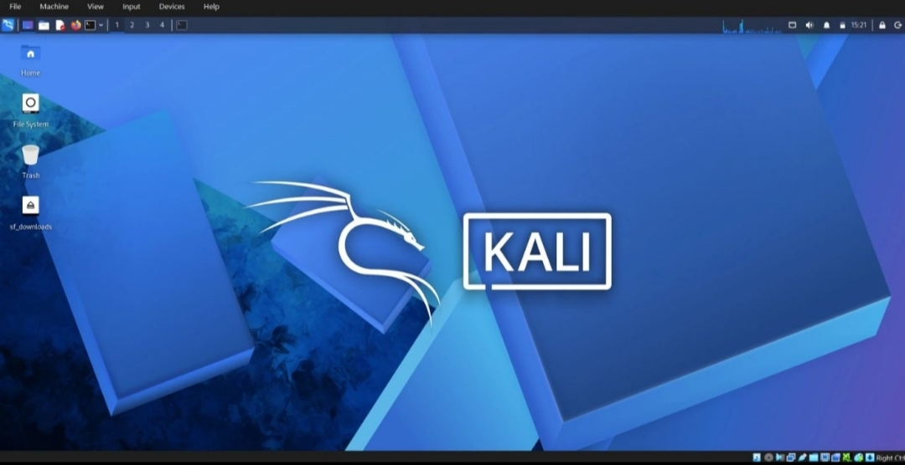

# NETWORKWALKS-ABHINAV-BO84-WK1-PM1-CYBERSECURITY-LAB-SETUP
CYBERSEURITY INTERNSHIP
# 🔐 Cybersecurity Lab Environment Setup

---

### Building a Virtual Lab for Cybersecurity and Ethical Hacking Practice

---

## 📌 Project Overview

This project focuses on setting up a virtual cybersecurity laboratory using Oracle VirtualBox and Kali Linux.

The purpose is to create a controlled environment for learning cybersecurity fundamentals, understanding virtual machine networking, and preparing for future security-testing exercises.

The lab setup includes virtual machine configuration, network adapter configuration, and verification of the Kali Linux environment.

## 🎯 Objectives

The main objectives of this project are to:

- Install and configure Oracle VirtualBox.
- Import and configure Kali Linux as a virtual machine.
- Understand virtual machine network adapter settings.
- Configure network connectivity for Kali Linux.
- Verify the virtual machine's network configuration.
- Capture screenshots documenting the setup process.
- Prepare the environment for future cybersecurity projects.

## 🛡️ Purpose of the Lab

This laboratory provides a controlled environment for cybersecurity learning and authorized security testing.

Future exercises may include:

- Network reconnaissance
- Port scanning
- Vulnerability assessment
- Packet analysis
- Web security testing
- Security tool experimentation

⚠️ **Ethical Use:** Use cybersecurity tools only on systems you own or have explicit permission to test.

---

## 🏗️ Lab Architecture

The lab uses Oracle VirtualBox to run Kali Linux as a virtual machine on a Windows host.

**Basic architecture:**

```
        Physical Computer
        (Windows Host OS)
               |
               |
        Oracle VirtualBox
               |
               |
          Kali Linux VM
               |
               |
     Virtual Network Adapter
               |
               |
    Configured Lab Network
```

Additional virtual machines can be added in future exercises if required.

---

## ⚙️ Lab Configuration

| Component | Configuration |
|---|---|
| Host Operating System | Windows |
| Hypervisor | Oracle VirtualBox |
| Security Operating System | Kali Linux |
| Virtual Machine Memory | 2048 MB |
| Network Adapter | Adapter 1, attached to NAT Network (NatNetwork) |
| Adapter Type | Intel PRO/1000 MT Desktop (82540EM) |
| Promiscuous Mode | Allow All |
| Project | Week 1 – Project Module 1 |

---

## 🪜 Lab Setup Procedure

### Step 1: Prepare the Virtualization Environment

Prepared the computer for running virtual machines and checked the requirements for installing the necessary virtualization software.

### Step 2: Install Oracle VirtualBox

Installed Oracle VirtualBox to create and manage the Kali Linux virtual machine.

### Step 3: Configure the Virtual Machine

Configured the Kali Linux virtual machine in VirtualBox and reviewed its hardware settings.

### Step 4: Configure Network Settings

Reviewed the virtual machine's network adapter configuration and selected the network mode required for the lab. Adapter 1 was enabled and attached to a NAT Network.

### Step 5: Start Kali Linux

Started the Kali Linux virtual machine and checked that the operating system loaded successfully.

### Step 6: Verify the Lab Environment

Checked the virtual machine configuration and network settings to confirm that the environment was ready for further testing.

### Step 7: Document the Setup

Captured screenshots of the configuration and setup process to document the work completed.

---

## 📸 Project Screenshots

The following screenshots document the lab setup.

### 1. Kali Linux Virtual Machine



### 2. VirtualBox Network Adapter Settings

Adapter 1 is enabled and attached to a NAT Network, with promiscuous mode set to Allow All and the virtual cable connected.


### 3. Network Connectivity Verification

Opened the browser inside Kali Linux and searched Google for "cybersecurity" to confirm the VM has internet access.


---

## 🐞 Problems Encountered and Troubleshooting

During the setup process, technical issues may occur while configuring the virtual machine or its network connection.

### Problem 1: Network Connectivity

**Issue:** The virtual machine may not connect to the network correctly.

**Troubleshooting:**

- Checked the VirtualBox network adapter settings.
- Verified that the correct network mode was selected.
- Reviewed the Kali Linux network configuration.
- Tested connectivity after making the necessary changes.

**Result:** After setting the adapter to NAT Network, Kali Linux was able to load Google in the browser, confirming internet connectivity.

### Problem 2: Virtual Machine Configuration

**Issue:** The virtual machine may require changes to its configuration before it starts or operates correctly.

**Troubleshooting:**

- Reviewed the virtual machine's settings.
- Checked the virtualization configuration.
- Restarted the virtual machine after applying any necessary changes.

**Result:** Document the actual issue and the solution you used.

---

## 💡 What I Learned

Through this project, I developed a better understanding of:

1. **Virtualization:** How VirtualBox runs an operating system inside a virtual machine.
2. **Kali Linux:** How to start and configure a Linux-based cybersecurity environment.
3. **Virtual Networking:** How network adapter settings affect virtual machine connectivity.

---

## 🔐 Security and Ethical Use

This laboratory is intended for educational purposes and authorized cybersecurity testing only.

Any future scanning, penetration testing, or vulnerability assessment must be performed on systems for which permission has been granted.

---

## 🔗 Tools and Resources

- [Oracle VirtualBox](https://www.virtualbox.org/)
- [Kali Linux Official Website](https://www.kali.org/)
- [7-Zip](https://www.7-zip.org/)

---

## 👤 Author

**Name:** Abhinav Nair  
**Program:** Cybersecurity Training  
**Organization:** NetworkWalks  
**Project:** Week 1 – Project Module 1

---

## 📌 Project Information

| Field | Details |
|---|---|
| Program | Cybersecurity at NetworkWalks |
| Week | 01 |
| Project Module | PM1 |
| Project Title | Cybersecurity Lab Setup Using VirtualBox and Kali Linux |
| Repository | GitHub |

---

*This repository documents the Week 1 cybersecurity lab setup and provides a foundation for future learning and practical exercises.*
